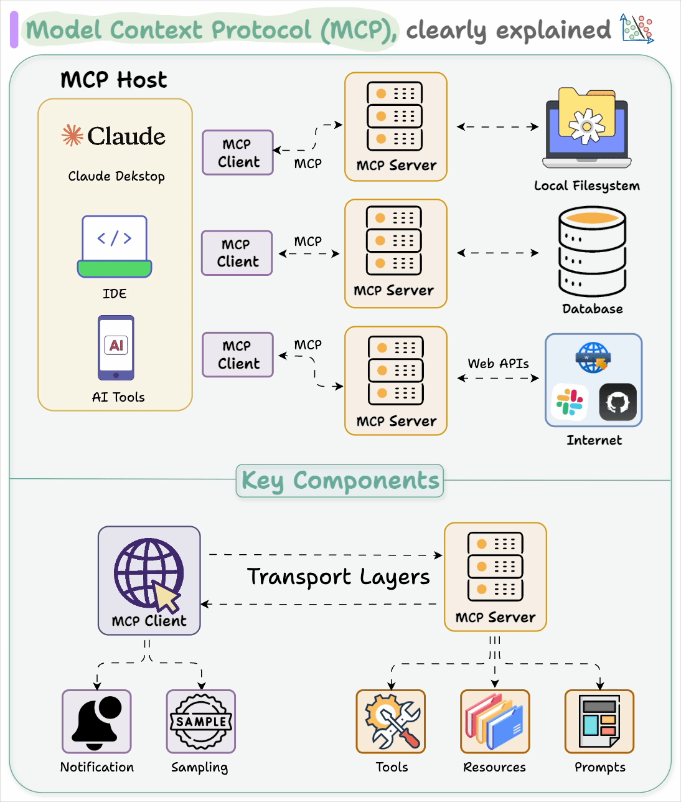
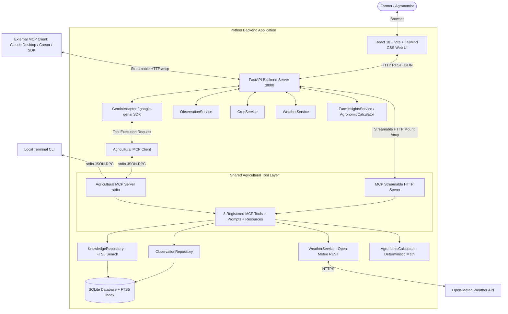

# Agricultural MCP Assistant

<p align="center">
  
</p>

A production-grade, full-stack, AI-powered agricultural decision-support system designed for smallholder farmers, agricultural extension workers, and agronomists. It integrates crop disease pathology search, localized meteorological forecasts, persistent farm observation management, historical trend summaries, and deterministic agronomic calculations using Google Gemini tool calling and the Model Context Protocol (MCP) over both **stdio and Streamable HTTP transports**.

---

## A. Project Overview

The **Agricultural MCP Assistant** is an AI-powered application designed to support agricultural information retrieval and farm-observation management through the **Model Context Protocol (MCP)**. It bridges modern foundation AI models with local agricultural realities for smallholder farmers, agricultural extension workers, and agronomists in Eastern Africa (with regional focus on Ethiopia).

The primary goal is to demonstrate how an AI assistant can interact with external tools and structured data sources instead of relying only on its built-in language capabilities. By connecting an AI model (Google Gemini) to an MCP server, the application can retrieve relevant agricultural knowledge, access live weather forecasts, perform supported agronomic calculations, manage persistent farm observation records, and present everything through an intuitive web interface.

> 📄 **Companion Documents & Reports:**
> - [Project Evaluation Report (`docs/project-report.md`)](docs/project-report.md) — Complete overview report based on project specifications.
> - [Architecture & Implementation Summary (`SUMMARY.md`)](SUMMARY.md) — Technical deep-dive and two-tool demo reproducibility.
> - [Requirement Completion Matrix (`docs/phase-completion-matrix.md`)](docs/phase-completion-matrix.md) — Verification tracking across Phases 1–8.
> - [Google Docs Reference](https://docs.google.com/document/d/1FmpE9E8Iiw8ysO2DdyMx9ADGxAJ6nblnFDpz-wEz1ws/edit?usp=sharing)

### Main Objectives
* **Develop a custom MCP server** with agricultural tools.
* **Support both local standard-input/output (stdio) and remote Streamable HTTP transports.**
* **Integrate an AI model** that can select and call available tools.
* **Provide agricultural knowledge search** and weather information.
* **Store and retrieve farm observations** using a database.
* **Present the main features** through a web interface.
* **Implement basic safeguards** for operations that modify stored information.
* **Provide documentation and automated tests** to support evaluation and future development.

### Problems Addressed
1. **Access to Vetted Agricultural Knowledge:** Provides instant access to pathology data sourced directly from the **Ethiopian Institute of Agricultural Research (EIAR)** and **CABI PlantwisePlus Knowledge Bank**, avoiding unverified hallucinated treatments.
2. **Actionable Weather Intelligence:** Delivers localized 1–14 day high-resolution meteorological forecasts via **Open-Meteo** without requiring paid API access.
3. **Structured Field Recordkeeping:** Replaces lost paper records with a local SQLite database that records field observations, phenological stages, and spatial coordinates.
4. **Data-Driven Agronomic Insights:** Deterministically computes critical thermal heat units (Growing Degree Days - GDD) and precipitation dry-spell indices from daily weather records.
5. **Safe AI Interaction:** Enforces strict **human-in-the-loop write safety**; the AI assistant can suggest and draft farm observations, but never mutates the database without explicit user confirmation.

### Role of the Model Context Protocol (MCP)
The Model Context Protocol (MCP) provides an open, standardized contract decoupling the AI reasoning engine from tool execution and data persistence. In this project:
- **Shared Agricultural Tools:** 8 specialized agricultural tools are registered once in a shared service layer.
- **Dual Transports:** The MCP server natively serves both **local stdio** (for local CLI and desktop host applications like Claude Desktop or Cursor) and **Streamable HTTP** (`/mcp` endpoint for remote and web-based MCP clients).
- **Extensible:** Allows any MCP-compliant client to consume agricultural intelligence, resources, and prompt templates without modifying backend business logic.

---

## B. Feature List

- **Gemini-Powered Agricultural Assistant:** Multi-turn conversational guidance powered by Google Gemini (`gemini-3.5-flash` / `gemini-3.8-flash`) via the official Google GenAI SDK (`google-genai`). Features automatic OpenAPI schema-cleaning logic (`anyOf` flattening and `additionalProperties` pruning) to ensure robust Gemini tool compatibility.
- **Autonomous MCP Tool Calling:** The AI assistant dynamically discovers available MCP tools, executes requested functions through the MCP client, and synthesizes evidence-grounded answers with research citations.
- **Dual MCP Transports:**
  - **Local stdio Transport:** Standard input/output JSON-RPC for local clients and background CLI operations.
  - **Streamable HTTP Transport:** Standards-compliant MCP Streamable HTTP endpoint (`/mcp`) supporting initialization, session lifecycle, SSE streaming, and HTTP POST/DELETE methods.
- **MCP Prompts & Resources:**
  - Resource: `crops://catalog` (curated catalog of supported crops, scientific classifications, and agroecological zones).
  - Prompt: `agricultural_advisory_prompt` (structured prompt template for agronomic symptom evaluation).
- **Vetted Crop Disease Search (`search_crop_disease`):** Full-text search (SQLite FTS5) across regional pathology databases with symptoms, cultural practices, IPM recommendations, and source attribution (EIAR & CABI).
  > **Agricultural & Diagnostic Disclaimer:** The results depend on the knowledge base available in the application. The assistant is an advisory support tool and should not be treated as a substitute for professional agricultural diagnosis, extension agent verification, or laboratory field inspection.
- **Localized Weather Forecasts (`get_weather_forecast`):** 1–14 day forecasts (temperatures, rainfall sum, precipitation probability) with regional Ethiopian presets (Addis Ababa, Jimma, Hawassa, Bahir Dar, Mekelle) via Open-Meteo.
- **Farm Observations Management:** Provides persistent recordkeeping across 5 specialized tools:
  - `record_farm_observation`: Records validated observation with phenological stage and GPS coordinates (write-gated).
  - `get_farm_observation`: Retrieves a single observation by ID.
  - `list_farm_observations`: Lists and filters observations by crop and date with pagination.
  - `count_farm_observations`: Aggregates observation counts matching query criteria.
  - `summarize_farm_observations`: Produces statistical distributions by crop and growth stage.
  - *Demonstrates how an AI application interacts with persistent state across turns instead of treating every conversation as isolated.*
- **Deterministic Agronomic Calculator (`calculate_agronomic_metrics`):** Mathematical Growing Degree Days (GDD) with customizable base and cutoff temperatures, plus precipitation dry-day threshold analysis. Exposing calculations through a dedicated tool separates deterministic numerical operations from natural-language generation.
- **Deterministic Offline Fallback:** If internet connectivity is interrupted or Gemini free-tier quota is exhausted, the backend falls back to an offline deterministic intent resolver, allowing full local UI testing and development.
- **Point-in-Time SQLite Backup & Restore:** Online non-blocking database backup and restore via SQLite's native backup API.

---

## C. Architecture and Request Flows

### System Architecture Diagram



### End-to-End Request Flows

#### 1. Asking an Agricultural Question (Web Chat)
1. Farmer enters: *"What are common symptoms of coffee leaf rust in Jimma?"* in the React chat interface.
2. React frontend issues `POST /api/chat` to the FastAPI backend.
3. `GeminiAdapter` receives the prompt, queries the MCP client for registered tool definitions, and converts them to Gemini `types.FunctionDeclaration`.
4. Gemini returns a tool-call request for `search_crop_disease(crop_name="Coffee", symptoms="rust")`.
5. `GeminiAdapter` passes the tool call to `AgriculturalMCPClient`, which invokes the tool over stdio on the local MCP server.
6. The MCP server executes SQLite FTS5 search and returns matching pathology data citing EIAR and CABI.
7. `GeminiAdapter` delivers tool results back to Gemini.
8. Gemini synthesizes a plain-language answer explaining symptoms, cultural management, and research citations, which appears in the chat UI.

#### 2. Recording a Farm Observation with Explicit Confirmation
1. Farmer fills in the Observation form (Crop: Coffee, Stage: Vegetative, Notes: *"Found orange powdery lesions on undersides of leaves"*, Location: Jimma).
2. Clicking **"Preview Observation"** submits `POST /api/observations/preview`. The backend validates all fields against domain constraints and returns a formatted preview.
3. The React UI displays the **Write Confirmation Modal**.
4. The database is **not** touched until the farmer explicitly clicks **"Authorize & Save Record"**.
5. The frontend sends `POST /api/observations/confirm`.
6. The backend invokes `record_farm_observation` via the MCP client, committing the row to SQLite and returning the new record ID.

#### 3. Connecting an MCP Client via Streamable HTTP
1. An external client (e.g. Python MCP SDK or remote IDE) connects to `http://localhost:8000/mcp`.
2. The client sends an HTTP POST with JSON-RPC initialization request (`initialize`).
3. The server assigns an MCP session ID, negotiates protocol version, and advertises capabilities.
4. The client issues `tools/list` to discover all 8 tools, `prompts/list` for advisory prompts, and `resources/list` for crop catalogs.
5. The client invokes `tools/call` with tool arguments and receives structured JSON results.
6. Upon closing, the client sends an HTTP DELETE request to cleanly terminate the session.

---

## D. Technology Stack

### Component Overview

| Component | Technology | Purpose |
| :--- | :--- | :--- |
| **Frontend** | React, TypeScript, Vite, Tailwind CSS | Responsive user interface, interactive dashboard, and build tooling |
| **Backend** | Python, FastAPI, Uvicorn, Pydantic | Application logic, service coordination, and REST routing |
| **AI Model Integration** | Google Gemini, Google Gen AI SDK (`google-genai`) | Autonomous multi-turn reasoning and dynamic tool calling |
| **Tool Protocol** | Model Context Protocol (MCP) | Standardized tool, resource, and prompt discovery and invocation |
| **Local Database** | SQLite (WAL mode, parameterized transactions) | Persistent farm-observation storage and transactional integrity |
| **Search Engine** | SQLite FTS5 | Full-text agricultural knowledge retrieval with BM25 ranking |
| **Weather Service** | Open-Meteo REST API | External meteorological forecasts without API key friction |
| **Backend Testing** | pytest, pytest-anyio | Automated backend unit and integration test suite |
| **Frontend Testing** | Vitest, React Testing Library, JSDOM | Automated frontend and write-confirmation modal checks |
| **MCP Validation** | MCP Inspector (stdio & Streamable HTTP) | Protocol validation of tools, resources, prompts, and sessions |

### Key Library Versions
- **AI Engine:** Google Gemini (`gemini-3.5-flash` / `gemini-3.8-flash`) via official `google-genai` SDK (v2.31.0+).
- **Model Context Protocol:** Official MCP Python SDK (`mcp` v2.3.0) with stdio and Streamable HTTP transports.
- **Backend Framework:** FastAPI (v0.115.0+), Uvicorn, Starlette, AnyIO, Pydantic (v2.10.0+).
- **Frontend Stack:** React 18, Vite 6, TypeScript 5.7, Tailwind CSS 3.4, Lucide React icons.
- **Database & Search:** SQLite 3 with WAL journal mode, parameterized SQL transactions, and SQLite FTS5 (Full-Text Search).
- **External Meteorological API:** Open-Meteo Weather Forecast API.
- **Testing Frameworks:** Pytest 9, Pytest-AnyIO, Vitest 5, React Testing Library, JSDOM.
- **Package & Dependency Management:** `uv` (Python), `npm` (Node.js).

---

## E. Prerequisites

- **Python:** Version 3.11 or 3.12+ installed.
- **uv:** Fast Python package and project manager (`curl -LsSf https://astral.sh/uv/install.sh | sh`).
- **Node.js & npm:** Node.js v18+ and `npm` installed.
- **Internet Connectivity:** Required for live Open-Meteo weather forecasts and live Google Gemini API calls.
- **Gemini API Key (Optional for Local Dev/Testing):** A Google AI Studio API key (`GEMINI_API_KEY`) for live AI responses. All automated unit, integration, and UI tests work 100% offline without an API key.

---

## F. Clone and Install

### 1. Clone the Repository
```bash
git clone https://github.com/Tesfalegnp/agri-mcp-agent.git
cd agri-mcp-agent
```
*(If checking out locally, use `cd /home/hope/Projects/agricultural-mcp-assistant`)*

### 2. Install Backend Python Dependencies
```bash
# Sync backend virtual environment with all core and test dependencies
uv sync --extra dev
```

### 3. Install Frontend Node Dependencies
```bash
cd frontend
npm install
cd ..
```

### 4. Database Setup
The SQLite database and FTS5 search index are initialized automatically with sample crop disease data upon backend startup. You can also trigger database initialization manually:
```bash
uv run python -c "from agricultural_assistant.storage.database import DatabaseManager; DatabaseManager().initialize()"
```

---

## G. Environment Configuration

### Setup `.env`
Copy `.env.example` to create your local `.env`:
```bash
cp .env.example .env
```

### Supported Configuration Variables

| Variable | Required | Default Value | Purpose |
| :--- | :---: | :--- | :--- |
| `GEMINI_API_KEY` | Optional | `None` | Google Gemini API key from Google AI Studio. |
| `GEMINI_MODEL` | Optional | `gemini-3.5-flash` | Gemini model name on the free tier (`gemini-3.5-flash` or `gemini-3.8-flash`). |
| `BACKEND_HOST` | Optional | `127.0.0.1` | Host address for the FastAPI backend server. |
| `BACKEND_PORT` | Optional | `8000` | Port for the FastAPI backend server. |
| `CORS_ORIGINS` | Optional | `http://localhost:5173,http://127.0.0.1:5173` | Allowed frontend origins for CORS. |
| `DATABASE_PATH` | Optional | `data/agricultural_assistant.db` | Relative or absolute path to SQLite database. |
| `OPEN_METEO_BASE_URL` | Optional | `https://api.open-meteo.com/v1/forecast` | Open-Meteo REST API endpoint. |
| `LOG_LEVEL` | Optional | `INFO` | Logging level (`DEBUG`, `INFO`, `WARNING`, `ERROR`). |
| `VITE_API_BASE_URL` | Optional | `http://localhost:8000` | Frontend backend API target URL. |

> **Security Notice:** `.env` is ignored by Git. Real API keys must never be committed.

---

## H. Run the Complete Application

### Terminal 1: Start the Backend Web API & Streamable HTTP Server
```bash
# Run backend on http://127.0.0.1:8000 (serves REST API + /mcp Streamable HTTP endpoint)
uv run uvicorn src.agricultural_assistant.api.app:create_app --factory --host 127.0.0.1 --port 8000 --reload
```

### Terminal 2: Start the React Frontend Development Server
```bash
cd frontend
npm run dev
```

### Access Application
Open **`http://localhost:5173`** in your browser.

### Health Check
Verify backend and MCP client status:
```bash
curl -s http://127.0.0.1:8000/api/health | jq
```
Expected output:
```json
{
  "status": "healthy",
  "mcp_server_connected": true,
  "tools_discovered": 8,
  "service": "Agricultural MCP Assistant",
  "version": "0.1.0"
}
```

---

## I. Run Both MCP Transports

### 1. Local stdio Transport

#### Start stdio Server Directly
```bash
uv run python -m agricultural_assistant.server.app --transport stdio
```

#### Client Configuration Example (Claude Desktop / Cursor)
Add to your `claude_desktop_config.json`:
```json
{
  "mcpServers": {
    "agricultural-assistant": {
      "command": "uv",
      "args": [
        "--directory",
        "/home/hope/Projects/agricultural-mcp-assistant",
        "run",
        "python",
        "-m",
        "agricultural_assistant.server.app",
        "--transport",
        "stdio"
      ]
    }
  }
}
```

### 2. Streamable HTTP Transport

#### Built-in with Web Backend
The Streamable HTTP transport is automatically mounted on the web backend at:
**`http://127.0.0.1:8000/mcp`**

#### Or Run as Standalone Server
```bash
uv run python -m agricultural_assistant.server.app --transport streamable-http --port 8001 --path /mcp
```

#### Test Streamable HTTP with Python Client
```python
import asyncio
from mcp.client.session import ClientSession
from mcp.client.streamable_http import streamable_http_client

async def main():
    async with streamable_http_client("http://127.0.0.1:8000/mcp") as (read_stream, write_stream):
        async with ClientSession(read_stream, write_stream) as session:
            await session.initialize()
            tools = await session.list_tools()
            print(f"Discovered {len(tools.tools)} tools over Streamable HTTP!")

            result = await session.call_tool(
                "search_crop_disease",
                arguments={"crop_name": "Teff", "symptoms": "rust spots"}
            )
            print("Tool result:", result.content[0].text[:120])

asyncio.run(main())
```

---

## J. Demonstration Walkthrough

Follow these steps to demonstrate the full application:

1. **Start Services:** Start backend on `:8000` and frontend on `:5173` as shown in Section H.
2. **Open Dashboard:** Navigate to `http://localhost:5173`. Confirm the health indicator displays `"System Healthy — 8 MCP Tools Connected"`.
3. **Ask an Agricultural Question (Chat):**
   - Click the **AI Assistant** tab.
   - Click the prompt chip: *"What are common symptoms of coffee leaf rust?"*
   - Observe the tool execution badge (`search_crop_disease`) and review the synthesized response citing EIAR and CABI with IPM cultural recommendations.
4. **Inspect Weather Forecast:**
   - Click the **Weather** tab.
   - Click the **Jimma** preset button.
   - Verify that 3-day temperatures, precipitation probability, and rainfall amounts are displayed directly from Open-Meteo.
5. **Search Crop Pathology Knowledge:**
   - Click the **Crop Pathology** tab.
   - Select **Maize** and enter symptoms: `holes in leaves and whorl damage`.
   - View the matching record for **Fall Armyworm (*Spodoptera frugiperda*)** with cultural and biological control recommendations.
6. **Record a Farm Observation with Confirmation:**
   - Click the **Farm Records** tab.
   - Select Crop: `Wheat`, Growth Stage: `Heading`, Location: `Bale Zone`.
   - Notes: `Yellow rust pustules observed in strips on leaf blades`.
   - Click **"Preview Observation"**.
   - Review the details in the **Write Authorization Modal**.
   - Click **"Authorize & Save Record"**.
   - Confirm the success alert and verify the new record appears immediately in the **Recorded Observations** list.
7. **Compute Agronomic Metrics:**
   - Scroll to **Agronomic Metrics Calculator** on the Farm Records page.
   - Enter Base Temperature: `10.0°C`, click **"Calculate GDD & Rain Indices"**.
   - Verify the calculated Cumulative GDD and Dry Spell summary.
8. **Verify Streamable HTTP MCP Access:**
   - In a terminal, run the protocol test: `uv run pytest tests/test_streamable_http.py`.
   - Verify that all 4 tests pass, confirming external client connectivity, capability negotiation, and tool execution over Streamable HTTP.

---

## K. Tests and Verification

### 1. Full Python Test Suite (139 Passing Tests)
```bash
uv run pytest -v
```
**Outcome:** **139 passed in ~16 seconds**
- `test_config.py`: 3 tests (secret masking, env loading)
- `test_crop_models.py`: 6 tests (validation, enums)
- `test_weather_models.py`: 10 tests (coordinate bounds, forecast days)
- `test_observation_models.py`: 11 tests (note length, coordinates)
- `test_database.py`: 4 tests (WAL mode, transactions, point-in-time backup/restore)
- `test_knowledge_repository.py`: 6 tests (FTS5 search, seeding, BM25 ranking)
- `test_observation_repository.py`: 5 tests (CRUD, SQL injection safety)
- `test_weather_service.py`: 6 tests (Open-Meteo mock, timeouts, errors)
- `test_crop_service.py`: 5 tests (caching, query parsing)
- `test_observation_service.py`: 6 tests (service validation, pagination)
- `test_insights_service.py`: 6 tests (mathematical GDD and rainfall index calculations)
- `test_server.py`: 7 tests (stdio MCP server tools, schema validation)
- `test_observation_tools.py`: 3 tests (observation tool discovery and execution)
- `test_insights_tools.py`: 3 tests (insights tool execution)
- `test_client.py`: 3 tests (custom MCP client session lifecycle)
- `test_end_to_end_mcp.py`: 1 test (end-to-end stdio tool discovery and invocation)
- `test_streamable_http.py`: 4 tests (Streamable HTTP initialization, tools, prompts, resources, tool calls)
- `test_gemini_adapter.py`: 11 tests (Gemini tool mapping, tool loop, write safety, offline fallback)
- `test_api_routes.py`: 11 tests (FastAPI endpoints, validation, preview/confirm flow)
- `test_llm_adapter.py`: 13 tests (legacy LLM regression tests)

### 2. Frontend Test Suite (5 Passing Tests)
```bash
cd frontend
npm test -- --run
```
**Outcome:** **5 passed in 2.15 seconds**
- Dashboard title & health indicator
- Chat submission and assistant response
- Weather forecast display with regional presets
- Crop pathology search with EIAR/CABI attribution
- Explicit confirmation modal for observation writes

### 3. Production Bundle Build
```bash
cd frontend
npm run build
```
**Outcome:** Built successfully in ~8.5 seconds (`dist/index.html` + asset bundles).

### 4. Python Compilation Check
```bash
uv run python -m py_compile src/agricultural_assistant/**/*.py tests/*.py
```
**Outcome:** Clean compilation with 0 syntax or type errors.

---

## L. Troubleshooting

| Issue | Cause | Solution |
| :--- | :--- | :--- |
| **Gemini Quota Exhausted (`429`)** | Gemini free-tier rate limit exceeded. | The backend automatically activates its deterministic offline intent resolver. You can continue using all tools and UI features without interruption. |
| **Backend Port Conflict (`8000`)** | Another process is using port 8000. | Start on a different port: `uv run uvicorn src.agricultural_assistant.api.app:create_app --factory --port 8005`, and update `VITE_API_BASE_URL` in `frontend/.env`. |
| **`Connection Refused` in Frontend** | Backend server is not running. | Run `uv run uvicorn src.agricultural_assistant.api.app:create_app --factory --port 8000` in Terminal 1. |
| **CORS Error in Browser** | Frontend origin not in allowed list. | Ensure `CORS_ORIGINS` in `.env` includes your frontend URL (default: `http://localhost:5173`). |
| **MCP stdio Protocol Pollution** | Debug statements printed to `stdout`. | Ensure all server logging uses `logger.info()` (which writes to `stderr`) and never raw `print()` statements. |
| **Streamable HTTP `404 Not Found`** | Connecting to wrong path. | Connect to `/mcp` (e.g. `http://localhost:8000/mcp`), not ordinary REST endpoints. |
| **Database Missing / Not Initialized** | First-time clone without database file. | Automatically initialized at startup; or run `DatabaseManager().initialize()`. |

---

## M. Security, Reliability, and Limitations

### Security and Reliability Safeguards
The project implements several security and operational reliability foundations:
* **Environment-Based Configuration:** All sensitive credentials and endpoints are loaded via environment variables with a masked `Settings.__repr__`.
* **Zero Secret Leakage:** The `.env` file is excluded from Git version control.
* **Default Loopback Binding:** The server binds to `127.0.0.1` by default, mitigating unintended network exposure during local development.
* **Human-in-the-Loop Write Gating:** Explicit confirmation is required before any mutating database tool (`record_farm_observation`) executes.
* **Database Backup & Restoration:** Online non-blocking SQLite hot backup and point-in-time recovery APIs are integrated and tested.

### Production Readiness Notice
These measures represent solid engineering foundations, but they do not establish that the application is fully production-ready or independently security-audited. Prior to public production deployment, a comprehensive review should be conducted covering:
- Authentication & Authorization (e.g., OAuth2 / OIDC multi-tenancy)
- Network exposure controls and TLS termination
- Dependency vulnerability auditing
- Comprehensive input validation and sanitization
- Centralized structured logging and APM monitoring
- Automated disaster recovery and backup verification

### Response Quality & External Limitations
- **Curated Knowledge Coverage:** Agricultural responses depend on the completeness of the curated knowledge base. The assistant is an advisory tool and must not replace professional on-site agronomic diagnosis or laboratory inspection.
- **External API Availability:** Weather forecasts rely on Open-Meteo, and live AI responses rely on Google Gemini. Network interruptions or quota exhaustion (429/503) trigger deterministic offline fallbacks to preserve application utility.

### Future Improvements & Roadmap
- **Production Containerization:** Docker and Docker Compose configuration for multi-container deployment.
- **Image-Based Pathology Diagnosis:** Computer vision model integration for smartphone leaf photograph diagnosis.
- **Multilingual UI:** Full localized Amharic (`am`) and Afaan Oromo (`om`) UI translations to complement backend domain model language support.

---

## N. Contribution and Project Structure

```text
agricultural-mcp-assistant/
├── .env.example                      # Sanitized environment template
├── .gitignore                        # Git exclusion rules (ignores .env, db, dist, node_modules)
├── pyproject.toml                    # Python project configuration & dependencies
├── README.md                         # Project documentation
├── SUMMARY.md                        # Architecture summary & two-tool demo reproducibility
├── docs/
│   ├── project-report.md             # Project evaluation report & architecture overview
│   └── phase-completion-matrix.md   # Requirement completion tracking across all phases
├── src/
│   └── agricultural_assistant/
│       ├── api/
│       │   ├── app.py                # FastAPI factory, lifespan, CORS, Streamable HTTP mount
│       │   └── routes.py             # REST endpoints (/api/chat, /weather, /diseases, etc.)
│       ├── client/
│       │   ├── cli.py                # Interactive terminal client
│       │   ├── gemini_adapter.py     # Gemini SDK tool calling & write safety intercept
│       │   └── mcp_client.py         # Custom asynchronous stdio MCP client
│       ├── config.py                 # Pydantic Settings with secret masking
│       ├── domain/                   # Pydantic models (crop, weather, observation)
│       ├── logging_config.py         # stderr logging configuration
│       ├── server/
│       │   └── app.py                # MCP Server with 8 tools, prompts, resources & multi-transport CLI
│       ├── services/                 # Business services (weather, crop, observations, insights)
│       └── storage/                  # SQLite DatabaseManager, FTS5 repository, migrations
├── frontend/
│   ├── src/
│   │   ├── api/client.ts             # Typed API client
│   │   ├── components/               # Navbar, WriteConfirmModal
│   │   ├── pages/                    # Dashboard, Chat, Weather, Diseases, Observations
│   │   ├── App.tsx                   # Main React routing and layout
│   │   └── test/App.test.tsx         # Vitest integration tests
│   ├── package.json
│   └── vite.config.ts
└── tests/                            # Comprehensive test suite (139 pytest tests)
    ├── test_api_routes.py
    ├── test_database.py              # Includes online backup/restore test
    ├── test_gemini_adapter.py
    ├── test_streamable_http.py       # Protocol-level Streamable HTTP tests
    └── ...
```

### Adding a New Agricultural Tool
To add a new tool without duplicating logic:
1. Implement the domain service logic in `src/agricultural_assistant/services/`.
2. Register the tool in `create_server()` in `src/agricultural_assistant/server/app.py` using `@app.tool()`.
3. Because both stdio and Streamable HTTP share `create_server()`, the tool is immediately available over both transports and to the Gemini AI assistant automatically!

---

## O. Conclusion & Acknowledgments

### Conclusion
The **Agricultural MCP Assistant** demonstrates the integration of an AI model with specialized agricultural tools through the Model Context Protocol. Its main contribution is the combination of agricultural knowledge retrieval, weather access, persistent farm-observation management, agronomic calculations, and an interactive web interface within a modular, extensible application.

The implementation illustrates how MCP provides a clean, standardized contract between an AI model and external capabilities, while comprehensive automated tests (139 backend + 5 frontend) and thorough documentation support reproducibility, safety, and evaluation.

### Author & Repository
- **Prepared by:** Tesfalegn Petros
- **Project Repository:** [https://github.com/Tesfalegnp/agri-mcp-agent](https://github.com/Tesfalegnp/agri-mcp-agent)
- **Reference Document:** [Agricultural MCP Assistant Google Doc](https://docs.google.com/document/d/1FmpE9E8Iiw8ysO2DdyMx9ADGxAJ6nblnFDpz-wEz1ws/edit?usp=sharing)

### Data & Research Sources
- **Ethiopian Institute of Agricultural Research (EIAR):** Crop pathology guidelines, regional agroecological classifications, and cultivar base temperatures.
- **CABI PlantwisePlus Knowledge Bank:** Open-access Integrated Pest Management (IPM) guidelines.
- **Open-Meteo:** High-resolution meteorological data under Open Database License (ODbL).

### Open Source Libraries
- Model Context Protocol Python SDK (`mcp`) by Anthropic.
- Google GenAI SDK (`google-genai`) by Google DeepMind.
- FastAPI by Sebastián Ramírez.
- Lucide Icons by Lucide Contributors.
