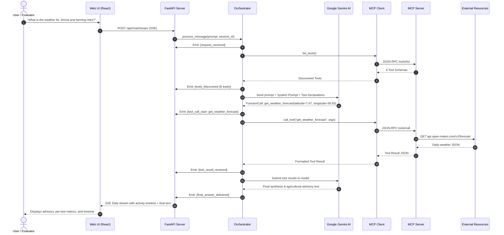
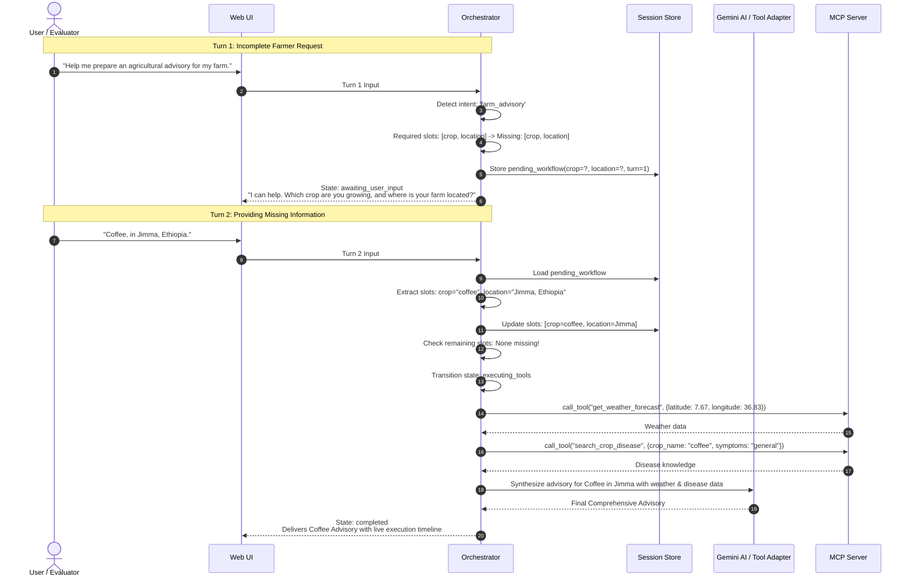
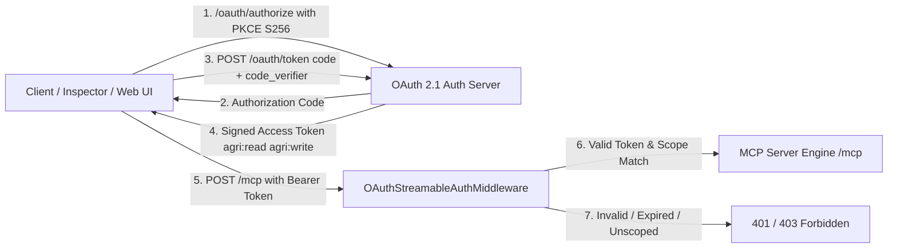

# Agricultural MCP Assistant — Architecture & Design Specification

> **System:** Agri MCP Agent  
> **Repository:** [https://github.com/Tesfalegnp/agri-mcp-agent](https://github.com/Tesfalegnp/agri-mcp-agent)  
> **Protocol Specification:** Model Context Protocol (MCP) Python SDK `v2.3.0` (Negotiated Protocol Version: `2026-07-28`)  
> **Security Specification:** Built-in Reference OAuth 2.1 Authorization Service (RFC 8414, RFC 7636 PKCE S256, RFC 7009, RFC 7662)  

---

## 1. End-to-End Architectural Overview

The Agricultural MCP Assistant follows a strict separation of concerns where LLM operations, conversational slot-filling, MCP client discovery, and MCP tool execution are decoupled into distinct layers.

```mermaid
graph TD
    User([Farmer / Agronomist / Evaluator]) <--> WebUI[React + TypeScript + Tailwind Web UI]
    WebUI <-->|HTTP REST & Server-Sent Events SSE| FastAPIServer[FastAPI Application Server :8000]
    
    subgraph Application Backend
        FastAPIServer --> Orchestrator[ConversationOrchestrator]
        Orchestrator --> GeminiAdapter[Gemini / LLM Adapter]
        Orchestrator --> MCPClient[AgriculturalMCPClient]
        FastAPIServer --> OAuthService[OAuth 2.1 Auth Server]
    end

    subgraph LLM Provider Boundary
        GeminiAdapter <-->|Function Calling Protocol| GeminiCloud[Google Gemini 2.5/3.5 Flash API]
    end

    subgraph MCP Transport Boundary
        MCPClient <-->|Transport A: Local Subprocess Stdio| StdioSubprocess[MCP Server Subprocess]
        MCPClient <-->|Transport B: Streamable HTTP with OAuth 2.1 Bearer| HTTPRoute[/mcp Streamable HTTP Endpoint]
        HTTPRoute --> StarletteApp[Starlette MCP Server Engine]
    end

    subgraph MCP Agricultural Capabilities
        StdioSubprocess --> MCPTools[8 Agricultural MCP Tools]
        StarletteApp --> MCPTools
        StdioSubprocess --> MCPResources[Resource: crops://catalog]
        StarletteApp --> MCPResources
        StdioSubprocess --> MCPPrompts[Prompt: agricultural_advisory_prompt]
        StarletteApp --> MCPPrompts
    end

    subgraph External Agricultural Resources
        MCPTools <-->|Resource 1: SQLite FTS5 Pathology Database| DB[(data/agricultural_assistant.db)]
        MCPTools <-->|Resource 2: REST Weather API with Backoff| OpenMeteo[Open-Meteo Global Forecast API]
    end
```

---

## 2. Component Responsibilities

| Layer / Component | Location | Strict Responsibility |
|---|---|---|
| **Web UI** | `frontend/src/` | Provides conversational chat, suggested query cards, real-time activity timeline, transport switcher, OAuth token loader, and MCP Primitives Inspector. Never directly accesses external agricultural APIs. |
| **Application API** | `src/agricultural_assistant/api/routes.py` | Exposes REST endpoints (`/api/chat`, `/api/chat/stream`, `/api/mcp/*`, `/api/oauth/*`), SSE progress piping, and session management. |
| **Agent Orchestrator** | `src/agricultural_assistant/client/orchestrator.py` | State machine governing multi-turn conversations (`idle`, `thinking`, `awaiting_user_input`, `discovering_tools`, `executing_tools`, `processing_results`, `completed`, `cancelled`). Detects missing required parameters before invoking tools, prompts the user, stores pending workflows, and resumes automatically upon clarification. |
| **LLM Adapter** | `src/agricultural_assistant/client/gemini_adapter.py` | Translates MCP tool schemas into provider-native tool declarations (e.g. Google GenAI `Tool` / `FunctionDeclaration`), receives function call requests, and formats execution results back to the model. |
| **MCP Client** | `src/agricultural_assistant/client/mcp_client.py` | Official MCP Python SDK client implementation. Manages session lifecycles for both `stdio` (subprocess) and `streamable-http` (remote HTTP with Bearer tokens). Introspects tools, resources, and prompts. |
| **MCP Server** | `src/agricultural_assistant/server/app.py` | Declares typed tools, input schemas, output schemas, resources, and prompts. Implements domain validation, rate limiting, and safe error handling. Outputs diagnostics strictly to stderr to prevent stdio protocol corruption. |
| **OAuth 2.1 Provider** | `src/agricultural_assistant/server/oauth.py` | Implements RFC 8414 metadata discovery, PKCE (S256) authorization code grant, client credentials, HMAC-SHA256 token verification, scope enforcement (`agri:read`, `agri:write`), and token revocation. |
| **External Resources** | `src/agricultural_assistant/services/` & `storage/` | **Resource 1:** SQLite 3 database with Full-Text Search (FTS5) for crop pathology and farm observations.<br>**Resource 2:** Open-Meteo REST API for live weather forecasts. |

---

## 3. Sequence Diagram — Normal Tool Execution Workflow



---

## 4. Sequence Diagram — Multi-Turn Clarification & Workflow Resumption



---

## 5. Transport Comparison: Local stdio vs Streamable HTTP

The Agricultural MCP Assistant natively implements both MCP transport protocols:

| Dimension | Local `stdio` Transport | Remote `Streamable HTTP` Transport |
|---|---|---|
| **Process Model** | Server runs as a local child subprocess managed by `subprocess.Popen` | Server runs within or alongside FastAPI Starlette HTTP engine (`/mcp`) |
| **Communication Channel** | Standard OS input/output streams (`stdin` / `stdout`) | HTTP POST and Server-Sent Events (SSE) streaming sessions |
| **Framing & Encoding** | JSON-RPC 2.0 lines terminated by `\n` | HTTP requests with `Content-Type: application/json` and SSE chunking |
| **Diagnostics & Logs** | Strictly written to `stderr` to avoid JSON-RPC stream corruption | Emitted through standard server logging frameworks |
| **Authentication / Security** | Local OS process boundary (inherits user permissions) | **OAuth 2.1 Protected** via `Authorization: Bearer <token>` |
| **Ideal Deployment** | Desktop IDEs (Claude Desktop, Antigravity IDE, Cursor) | Remote cloud containers, distributed microservices, multi-tenant agent platforms |
| **UI Toggle Mechanism** | Selected via top navigation switch; launches subprocess on demand | Selected via top navigation switch; connects to HTTP endpoint with Bearer token |

---

## 6. OAuth 2.1 Security Architecture

When the application operates over **Streamable HTTP**, endpoints are protected by an OAuth 2.1 authorization server implementation:



### Key Security Controls:
1. **RFC 7636 PKCE:** Mandatory for authorization code grants (`code_challenge_method=S256`).
2. **RFC 8414 Discovery:** Root discovery endpoint available at `/.well-known/oauth-authorization-server`.
3. **Granular Scopes:**
   - `agri:read`: Authorizes read-only operations (weather queries, disease searches, observation listing, metrics).
   - `agri:write`: Authorizes state-modifying operations (`record_farm_observation`). Enforced at the `/mcp` middleware boundary.
4. **Token Verification:** Signed with HMAC-SHA256, verifying issuer, audience (`/mcp`), expiration (`exp`), and active revocation status.
5. **Secret Redaction:** Tokens, client secrets, and database paths are masked in application logs via `sanitize_secrets`.
6. **Implementation Scope & Boundary:** The built-in authorization service is a self-contained reference implementation using symmetric HMAC-SHA256 signing. It does not implement asymmetric JWKS public-key fetching required by third-party enterprise IdPs (e.g. Okta, Auth0); integrating external IdP tokens would require extending the verifier with a JWKS client.
