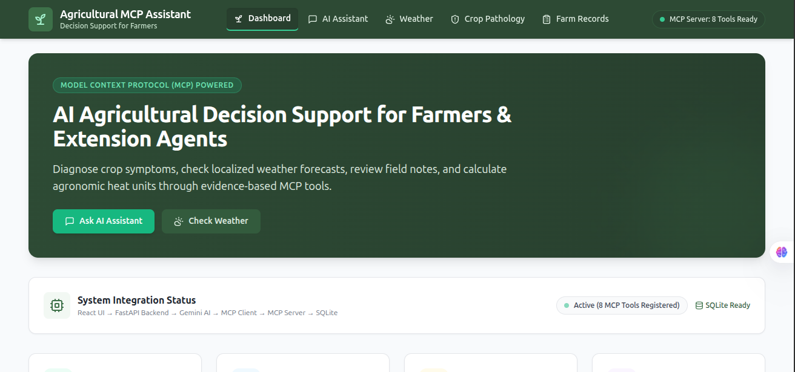
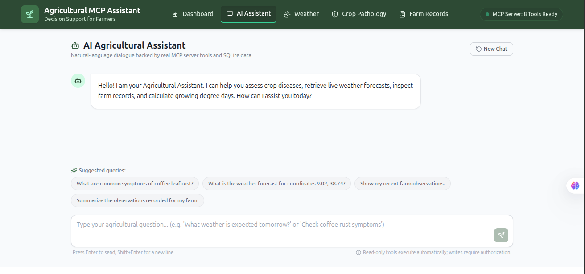
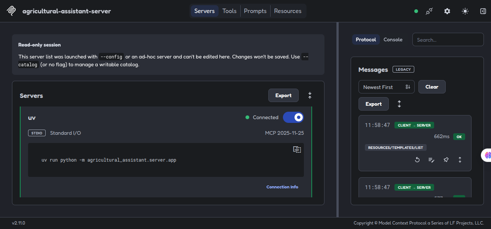
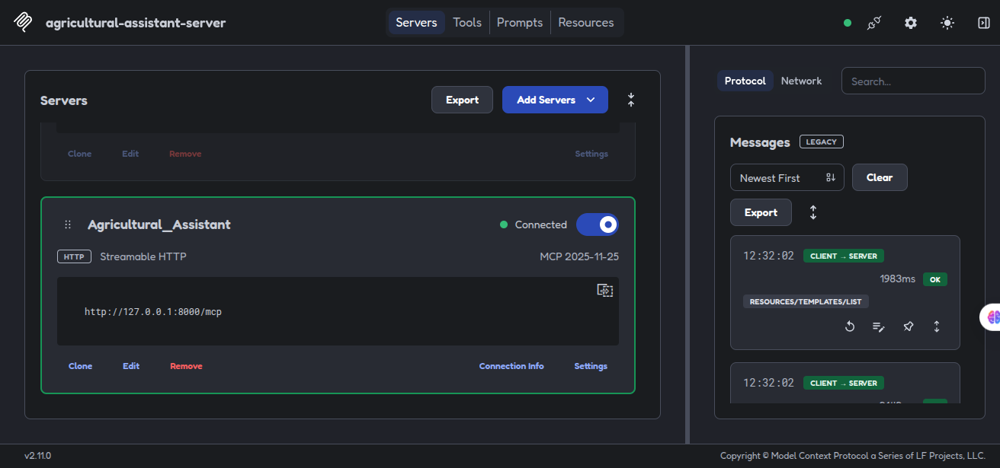

# Agricultural MCP Assistant

> **Project Report & Architecture Evaluation**  
> **Prepared by:** Tesfalegn Petros  
> **Project Repository:** [https://github.com/Tesfalegnp/agri-mcp-agent](https://github.com/Tesfalegnp/agri-mcp-agent)  
> **Source Document:** [Google Docs Reference](https://docs.google.com/document/d/1FmpE9E8Iiw8ysO2DdyMx9ADGxAJ6nblnFDpz-wEz1ws/edit?usp=sharing)

---

## 1. Project Overview

The **Agricultural MCP Assistant** is an AI-powered application designed to support agricultural information retrieval and farm-observation management through the **Model Context Protocol (MCP)**. It connects an AI model with specialized tools that provide agricultural knowledge, weather information, farm records, and agronomic calculations.

The primary goal is to demonstrate how an AI assistant can interact with external tools and structured data sources instead of relying only on its built-in language capabilities. By connecting the AI model to an MCP server, the application can retrieve relevant information, perform supported operations, and use the results to generate more useful agricultural responses.

The system combines a Python backend, an MCP server, a SQLite database, external weather information, a Gemini model integration, and a React-based web interface.

### Main Objectives
* **Develop a custom MCP server** with agricultural tools.
* **Support both local standard-input/output (stdio) and remote Streamable HTTP transports.**
* **Integrate an AI model** that can select and call available tools.
* **Provide agricultural knowledge search** and weather information.
* **Store and retrieve farm observations** using a database.
* **Present the main features** through an interactive web interface.
* **Implement basic safeguards** for operations that modify stored information.
* **Provide documentation and automated tests** to support evaluation and future development.

---

## 2. System Architecture

The application follows a modular architecture that separates the user interface, AI interaction, MCP tools, data storage, and external services.

```
[ User / Extension Worker ]
            |
            v
[ Frontend: React + TypeScript + Vite ]
            | (HTTP REST JSON)
            v
[ Backend: Python / FastAPI ]
      |                  \
      | (Tool Calling)    \ (Direct Routes / Static Mounts)
      v                    v
[ Google Gemini AI ]   [ SQLite DB / Open-Meteo ]
      |
      v (Tool Invocation Request)
[ Agricultural MCP Client ]
      | (stdio / Streamable HTTP)
      v
[ Agricultural MCP Server ]
      ├── search_crop_disease (SQLite FTS5)
      ├── get_weather_forecast (Open-Meteo API)
      ├── record_farm_observation (Write-gated)
      ├── get_farm_observation
      ├── list_farm_observations
      ├── count_farm_observations
      ├── summarize_farm_observations
      └── calculate_agronomic_metrics
```

### Main Components

1. **Frontend — React, TypeScript, and Vite:**  
   The frontend provides the user-facing interface. It includes sections for the dashboard, AI chat, weather, plant disease information, and farm observations. Users can interact with the assistant and view information returned by the backend.

   <p align="center">
     
   </p>

2. **Backend — Python:**  
   The backend coordinates application logic, database operations, external service integration, and communication between the AI model and the MCP tools.

3. **MCP Server:**  
   The MCP server exposes agricultural capabilities as structured tools that an MCP-compatible client can discover and invoke. It supports two transport options:
   * **stdio:** Suitable for local execution and integration with compatible MCP clients (e.g., Claude Desktop, Cursor, local CLI).
   * **Streamable HTTP:** Supports communication through an HTTP endpoint (`/mcp`) for remote-style client/server interaction.

4. **AI Integration — Google Gemini:**  
   The application uses the official Google Gen AI SDK to integrate Gemini with tool calling. When a request requires external information or an operation supported by the available tools, the model can request a tool call, receive the result, and use it to formulate a response.

5. **Database — SQLite:**  
   SQLite stores farm observations and supports retrieval, counting, summarization, and related operations. Full-text search using SQLite FTS5 supports agricultural knowledge retrieval.

6. **External Weather Service:**  
   The application uses Open-Meteo for weather information, allowing the assistant to retrieve relevant forecast data when needed.

### Architecture Flow

1. A user submits a question or request through the web interface.
2. The backend processes the request and coordinates with the AI model when appropriate.
3. The model can select an available MCP tool based on the request.
4. The tool retrieves agricultural knowledge, weather information, or stored farm data, or performs a supported calculation.
5. The tool returns structured results.
6. The AI model uses the returned information to prepare a response for the user.

*This architecture separates the language model from the application’s data and operations, making the tools easier to test, maintain, and extend.*

---

## 3. Implemented Features

### 3.1 Agricultural Knowledge Search
The `search_crop_disease` tool searches the available agricultural knowledge base using crop names and reported symptoms. It helps retrieve relevant crop-disease information for agricultural questions.

> **Disclaimer:** The results depend on the knowledge available in the application. The assistant should not be treated as a substitute for professional agricultural diagnosis or field inspection.

### 3.2 Weather Forecast Retrieval
The `get_weather_forecast` tool retrieves weather information through the external weather service (Open-Meteo). This capability allows the assistant to incorporate weather context into agricultural discussions when relevant.

### 3.3 Farm Observation Management
The system provides tools for recording and working with farm observations:
* `record_farm_observation` — records a farm observation.
* `get_farm_observation` — retrieves an observation.
* `list_farm_observations` — lists stored observations.
* `count_farm_observations` — counts observations matching supported criteria.
* `summarize_farm_observations` — summarizes stored observation data.

These tools demonstrate how an AI application can interact with persistent records rather than treating every conversation as isolated.

### 3.4 Agronomic Calculations
The `calculate_agronomic_metrics` tool provides supported agricultural calculations (such as Growing Degree Days and dry spell counts). Exposing calculations through a dedicated tool helps separate numerical operations from natural-language generation.

### 3.5 AI Tool Calling
The Gemini integration allows the model to use the available tools during a conversation. The application handles tool requests and results so that the model can combine retrieved information with its language-generation capabilities.

The implementation also includes schema-cleaning logic to make tool definitions compatible with the Gemini integration.

### 3.6 Web Interface and Safety
The web interface organizes the application's main capabilities into dashboard, chat, weather, pathology, and observation sections.

<p align="center">
  
</p>

For operations that write data, the application includes an explicit confirmation step. This provides an additional safeguard against unintended changes to stored farm information.

---

## 4. Technology Stack

| Component | Technology | Purpose |
| :--- | :--- | :--- |
| **Frontend** | React, TypeScript, Vite | User interface and frontend build |
| **Backend** | Python | Application logic and integration |
| **AI model integration** | Google Gemini, Google Gen AI SDK | AI responses and tool calling |
| **Tool protocol** | Model Context Protocol (MCP) | Tool discovery and invocation |
| **Local database** | SQLite | Persistent farm-observation storage |
| **Search** | SQLite FTS5 | Full-text agricultural knowledge retrieval |
| **Weather** | Open-Meteo | External weather information |
| **Backend testing** | pytest | Automated backend tests |
| **Frontend testing** | Frontend test suite (Vitest) | Automated frontend checks |
| **MCP validation** | MCP Inspector | Tool, resource, prompt, and transport checks |

### Dual Transport Validation (MCP Inspector)

Both stdio and Streamable HTTP transports have been validated using the official MCP Inspector:

<p align="center">
  
</p>

<p align="center">
  
</p>

---

## 5. Security, Reliability, and Limitations

The project includes several basic security and reliability considerations:
* **Environment-based configuration** is used for sensitive settings.
* **The `.env` file** is configured to be excluded from version control.
* **Configuration representations** are designed to mask sensitive values.
* **The server uses a loopback binding** (`127.0.0.1`) by default, reducing unintended network exposure during local development.
* **Explicit confirmation** is required for data-writing operations.
* **Database backup and restoration** functionality is included.

### Production Readiness Notice
These measures are useful foundations, but they do not establish that the application is production-ready or independently security-audited. Before public deployment, configuration, authentication, authorization, network exposure, dependency security, input validation, logging, and backup recovery should be reviewed.

### Response Quality Limitations
The quality of agricultural responses also depends on the completeness and reliability of the knowledge base, the availability of external services, and the accuracy of the information supplied by users. Weather and AI services may fail or return incomplete results, so appropriate error handling and clear user communication remain important.

---

## 6. Conclusion

The **Agricultural MCP Assistant** demonstrates the integration of an AI model with specialized agricultural tools through the Model Context Protocol. Its main contribution is the combination of agricultural knowledge retrieval, weather access, persistent farm-observation management, agronomic calculations, and a web interface within a modular application.

The implementation illustrates how MCP can provide a structured interface between an AI model and external capabilities, while automated tests and documentation support reproducibility and evaluation.

Based on the reported implementation and test results, the project appears to have reached its main development goals. The recommended final step is to compare the completed repository against the original assignment instructions, confirm the latest code is available on GitHub, and verify that a fresh setup follows the documented steps.

---

**Project Repository:** [https://github.com/Tesfalegnp/agri-mcp-agent](https://github.com/Tesfalegnp/agri-mcp-agent)  
**Prepared by:** Tesfalegn Petros
